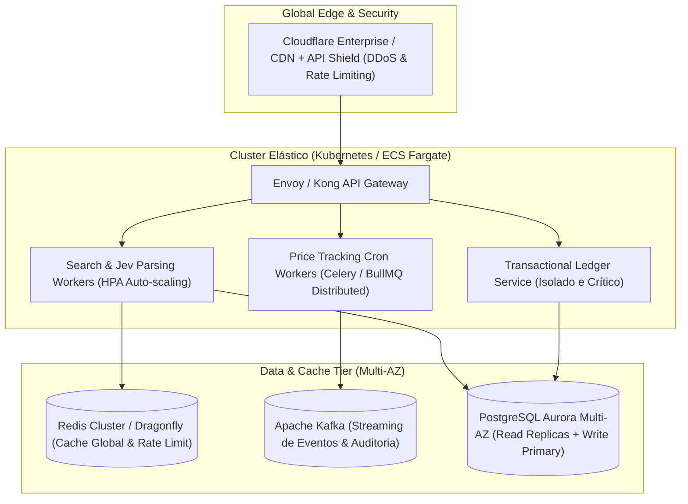
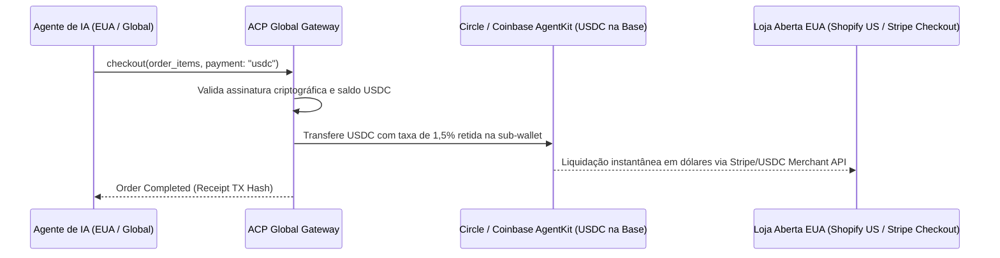

# AgentCommerce Protocol (ACP) - Arquitetura de Escalabilidade Global & Produção

> **Visão de Engenharia de Escala:** Este documento detalha a transição do ACP do estágio de MVP (KVM única na Hostinger) para uma infraestrutura distribuída, elástica e pronta para atender centenas de milhares de agentes autônomos de IA globalmente, com foco especial na expansão para os Estados Unidos.

---

## 1. O Padrão de Carga dos Agentes de IA vs. Humanos

Humanos navegam pausadamente e realizam poucas requisições por minuto. Agentes de IA operam em **rajadas massivas e simultâneas (*bursts*)**:
* Um único framework (ex: CrewAI com 5 agentes) pode disparar 30 chamadas de comparação e auditoria de preços em menos de 3 segundos.
* Com 10.000 usuários ativos rodando agentes de compras, a plataforma enfrentará **picos de 50.000 a 100.000 requisições/minuto**.
* **95% do tráfego é leitura e comparação (`search` e `track`)**, enquanto **5% é escrita transacional financeira (`checkout`)**.

---

## 2. Topologia de Infraestrutura: Da KVM para Nuvem Elástica

### Estratégias de Escalabilidade Horizontal:
1. **Separação CQRS (Command Query Responsibility Segregation):**
   * **Serviço de Busca (Query):** Escala horizontalmente de 2 para 50 réplicas com base na fila de requisições. Lê de réplicas de leitura do PostgreSQL e do cache Redis.
   * **Serviço de Checkout & Ledger (Command):** Microsserviço isolado, com menos réplicas, mas recursos dedicados e isolamento de banco para garantir que picos de busca nunca interfiram na liquidação de dinheiro.
2. **Cache em Camadas (Multi-Tier Caching):**
   * Consultas frequentes (ex: "iPhone 15", "MacBook Pro M3") ficam cacheadas por 5 a 15 minutos no Redis global. Se 1.000 agentes buscarem o mesmo produto, 999 recebem a resposta em $< 5\text{ms}$ sem onerar scrapers nem e-commerces.

---

## 3. Escalabilidade Financeira: Ledger de Alta Concorrência

Em escala com milhares de agentes debitando contas, travas tradicionais de linha no banco (`SELECT ... FOR UPDATE`) podem gerar gargalos de contenção.

### Evolução do Ledger:
* **Fase 1 (MVP):** PostgreSQL transacional com constraints rígidas e ACID.
* **Fase 2 (Escala): Ledger Baseado em Event Sourcing & TigerBeetle:**
  * Toda transação é um log imutável de débito e crédito (partidas dobradas).
  * O saldo da carteira é a soma dos eventos ou mantido em estado quente no Redis com reconciliação assíncrona periódica no PostgreSQL.
  * Proteção absoluta contra *double-spending* mesmo sob dezenas de milhares de requisições concorrentes.

---

## 4. Expansão Internacional: O Caso dos Estados Unidos

Nos EUA não existe o Pix. O sistema bancário tradicional americano possui fricções severas:
* **ACH:** Leva de 2 a 3 dias úteis para compensação.
* **Cartões de Crédito:** Cobram de 2,9% a 3,5% + $0,30 por transação, além de alto risco de *chargebacks* fraudulentos.

### A Solução Nativa de IA para os EUA: Stablecoins (USDC)
Para o mercado norte-americano e global, o ACP adotará o **padrão de pagamentos nativo de agentes**:

1. **Protocolo Base / Solana com USDC:**
   * Utilização de redes de camada 2 ultrarrápidas (**Base** ou **Solana**).
   * **Custo por transação:** $< \$0,005$ (frações de centavo).
   * **Tempo de liquidação:** $< 2$ segundos.
   * **Zero fricção de câmbio:** Desenvolvedores de qualquer lugar do mundo (São Francisco, Tóquio, Berlim) podem financiar seus agentes instantaneamente sem abrir conta bancária americana.
2. **Integração com Coinbase AgentKit & Stripe Agent Toolkit:**
   * Alinhar o protocolo ACP com as ferramentas abertas de carteiras de IA promovidas pela Coinbase e Stripe nos EUA.

---

## 5. Infraestrutura Distribuída de Busca & Redes Anti-Bot

Ao pesquisar milhares de produtos por minuto, grandes e-commerces (Amazon, Best Buy, Walmart, Mercado Livre) detectam e bloqueiam requisições de servidores comuns.

### Estratégia de Rede Distribuída:
1. **Rede de Proxies Residenciais Rotativos (Smart Proxy Layer):**
   * Parceria com redes de proxy empresarial (BrightData, Decoy ou Oxylabs).
   * Rotação de IPs residenciais por requisição com emulação precisa de fingerprints TLS (JA3/JA4) e HTTP/2.
2. **Data Feeds Oficiais de Afiliados:**
   * Conforme o ACP ganha volume, a plataforma migra do scraping para **APIs oficiais de grandes redes** (Amazon Creators API, Mercado Livre Partner API, CJ Affiliate, Impact).
   * Em vez de raspar dados, o ACP ingere catálogos e atualizações de preços diretamente via webhooks e feeds de dados em massa.

---

## 6. Governança, Proteção contra Loops Infinitos & Resiliência

Agentes de IA são propensos a falhas de raciocínio, loops infinitos de chamadas e alucinações. Para ser *production-ready*, o ACP precisa proteger a infraestrutura e o bolso do cliente:

* **Token Bucket Rate Limiting com Custo Ponderado:**
  * O limite de requisições não é apenas por chamada, mas ponderado pelo custo computacional (`search` consome 1 crédito, `checkout` consome 5 créditos).
* **Circuit Breakers Automáticos:**
  * Se um agente chamar `track_price_and_stock` mais de 20 vezes no mesmo minuto para o mesmo produto, a API desacelera e responde com HTTP 429 e uma instrução semântica: *"Loop detectado: intervalo mínimo de 60s imposto automaticamente"*.
* **Dead Letter Queues (DLQ) & Idempotência Estrita:**
  * Toda chamada de `checkout` exige um header de idempotência (`Idempotency-Key: uuid`). Se o agente reenviar a requisição por instabilidade de rede, nenhuma segunda cobrança será efetuada.

---

## Resumo dos Marcos de Escalabilidade

| Fase | Foco Tecnológico | Mercado Alvo | Métricas Chave |
| :--- | :--- | :--- | :--- |
| **Fase 1 (MVP)** | VPS KVM (Hostinger), Docker Compose, Pix BaaS | Brasil | Até 1.000 req/dia, 100 agentes |
| **Fase 2 (Scale Brasil)** | AWS/GCP, Cluster PostgreSQL Aurora, Celery + Redis | Brasil | 100.000 req/dia, 5.000 agentes |
| **Fase 3 (Expansão EUA & Global)** | Kubernetes multi-região, USDC (Base/Solana), Coinbase AgentKit | EUA e Internacional | +1.000.000 req/dia, liquidação global em USDC |
